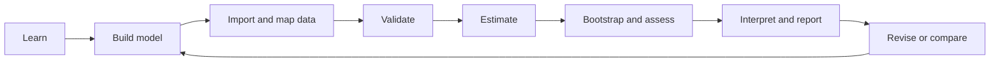
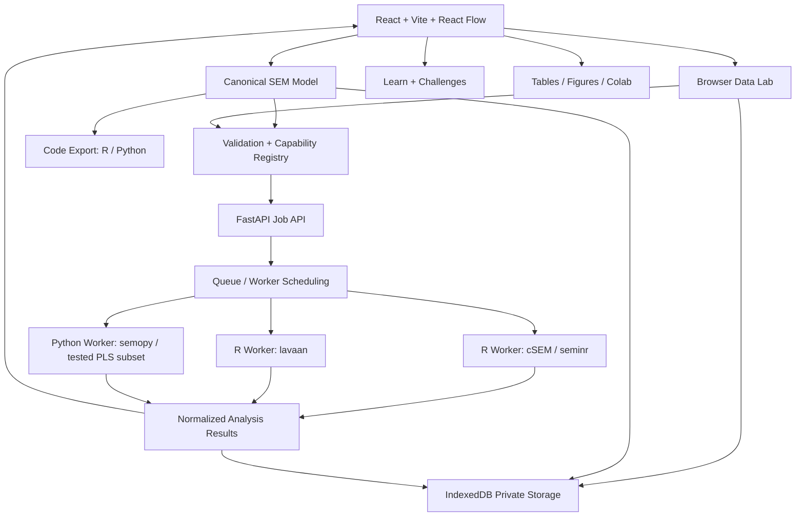

# SEM Studio — PLAN.md

> **Implementation blueprint for Codex / Claude Code and other development agents**  
> **New application** — not a retrofit of BPMN Studio. Reuse BPMN Studio's architectural discipline and its visual language through `STYLE.md`, not its BPMN-specific dependencies.  
> **Status:** Proposed architecture and delivery plan; no features in this document are claimed to be implemented.  
> **Last reviewed:** 2026-11-16

# 1. Executive Product Brief

## 1.1 Identity and purpose

**Working name:** SEM Studio  
**Full name:** Interactive Structural Equation Modeling, Statistical Analysis and Learning Environment  
**Priority:** P1  
**Application type:** Research-capable, interactive educational web application  
**Primary users:** Undergraduate and graduate students, doctoral researchers, lecturers, and applied researchers in information systems, business, management, marketing, education, and social sciences.

**Positioning:** A polished, accessible visual workspace for **PLS-SEM** and **CB-SEM**, inspired by the usability of tools such as SmartPLS while independently designed and implemented. SEM Studio must not reproduce proprietary SmartPLS code, artwork, interface assets, or restricted datasets.

### Vision

SEM Studio is **not merely a path-diagram editor**. A student should be able to start with a theoretical model, assign survey indicators, import or generate suitable data, select an appropriate estimator, inspect measurement and structural quality, estimate bootstrap confidence intervals, visualize the results, prepare Word-ready tables, export reproducible R/Python scripts, and explain the findings.

### Core learning and research cycle



### Non-negotiable product qualities

1. **Statistical validity before visual polish:** no fabricated numbers, hidden assumptions, or invented significance levels.
2. **Correct distinction between PLS-SEM and CB-SEM:** never treat composite and common-factor models as mathematically interchangeable.
3. **Traceable estimates:** every result identifies model version, dataset fingerprint, estimator, backend, options, software version, seed, and run identifier.
4. **Visual clarity:** diagrams use clean typography, restrained colors, intelligent alignment, grid snapping, readable connectors, and publication-ready export.
5. **Educational transparency:** explain *why* a test matters, not just whether a cutoff was exceeded.
6. **Reproducibility:** results and exported code must be verifiable against documented benchmark fixtures.
7. **Practical publishing:** tables copy into Word/Google Docs as actual tables, not screenshots.
8. **Deployability:** frontend on Netlify, calculation services on Railway, complete local development workflow.
9. **Security:** imported data are private by default; generated scripts are downloadable, not executed as untrusted arbitrary code on shared services.
10. **Incremental delivery:** finish one tested vertical slice end to end before implementing the full algorithm catalog.

## 1.2 Methodology boundaries

| Dimension | PLS-SEM | CB-SEM |
|---|---|---|
| Primary framing | Composite-based estimation; explanatory/predictive applications | Covariance-based common-factor estimation; confirmatory theory testing |
| Measurement | Reflective and composite/formative specifications, with method-specific semantics | Predominantly common factors; formative/composite adaptations require specialized, explicitly validated models |
| Estimators | PLS path modeling, PLSc and supported variants | ML, robust ML, WLS/DWLS/WLSMV where backend supports each configuration |
| Typical reporting | Weights, loadings, reliability/validity where applicable, paths, R², f², predictive assessment | Standardized loadings, factor correlations, fit indices, paths, standard errors, modification indices (with safeguards) |
| Bootstrapping | Resample rows, re-estimate entire model | Resample rows under chosen estimator; constraints documented |
| Important caveat | Conventional PLS composite scores are not interchangeable with CB latent factors | Global fit indices do not automatically validate construct theory or causal claims |

**Method-selection wizard:** Explain the purpose, construct ontology, estimator assumptions, indicator scale, sample size and power, normality / ordinal measurement, missingness, and research question. It recommends a *workflow*, not a scientifically authoritative one-click answer. Avoid the obsolete “10-times rule” as a substitute for a defensible sample-size analysis.

## 1.3 Product navigation

- **Overview** — start new study, reopen projects, examples, recent analyses.
- **Modeler** — visual latent-variable model and indicator mapping.
- **Data** — CSV inspection, mappings, cleaning, transformations, missing-data diagnostics.
- **Analysis** — algorithm configuration, estimation, bootstrap jobs, run history.
- **Results** — measurement assessment, structural results, fit, prediction, IPMA, export.
- **Model comparison** — PLS vs CB where meaningful, model variants, groups.
- **Examples & Colab** — five runnable Python notebook tutorials with bundled or generated data.
- **Learn** — structured theory and interactive lessons.
- **Challenges** — graded model-building, diagnosis, and interpretation exercises.
- **Reference** — concepts, notation, methods, formulas, software limitations.
- **Settings** — theme, privacy, computation, formatting, local/backend status.

---

# 2. Functional Modules

## 2.1 Module A — Visual SEM Modeler (React Flow)

### Objective

Create visually precise SEM diagrams that can be edited quickly and understood at a glance. **React Flow (`@xyflow/react`)** is the diagram foundation; domain semantics live in typed, independent model contracts.

### Node types

- **Latent construct** — rounded or elliptical clean construct node with name, classification, optional result badge.
- **Observed indicator** — compact rectangle showing variable code and friendly label.
- **Grouping container / higher-order construct** — grouping and drill-down; do not pretend a visual group implies an estimable higher-order method.
- **Annotation** — educational comments, hypotheses, methodological warnings.

### Edge types

- **Structural regression path:** directed single arrow between constructs.
- **Reflective measurement:** arrow from construct to indicator (common factor or reflective specification according to method).
- **Formative/composite weight:** arrow from indicator into construct, with explicit measurement type.
- **Covariance / correlated disturbance:** curved double-headed edge, permitted for CB-SEM where valid.
- **Higher-order / interaction relations:** dedicated semantic edge and properties, not ordinary unlabeled paths.
- **Result overlay:** label a valid edge with estimate, significance, and precision; this is not a new edge type in the scientific model.

### Required interactions

- Drag nodes from a palette or use a quick-create menu.
- Create construct, attach indicators from mapped columns, bind observed variables, edit properties.
- Create edges via handles; prevent duplicates and semantically invalid connections.
- Multi-select, lasso selection, duplicate, cut/copy/paste, delete, undo/redo, keyboard shortcuts.
- Smooth pan/zoom/fit; zoom to construct, search/filter indicators, mini-map toggle.
- Autosave drafts in IndexedDB; manual save as portable project JSON.
- Inspector: **Construct | Indicators | Paths | Constraints | Data | Results | Learn** as context warrants.
- Toggle **Model view / Estimates view / Bootstrap view / Presentation view** without changing model semantics.
- Support concise and expanded measurement-diagram views; collapse/expand indicator sets.
- Preserve stable element IDs and user layout when analysis results are refreshed.
- Export diagram to SVG, PNG (print-resolution controlled), and clean PDF if supported by an explicit exporter; include transparent background option.

### High-quality auto layout and alignment (P1)

- **Snap to grid:** configurable grid default `16px` (with visible/faint/hidden grid options); default on; Alt/Option drag may temporarily bypass if appropriate.
- **Alignment guides:** smart guides during dragging with horizontal/vertical centers and edges; clear visual snap preview.
- **One-click Align:** left, center, right, top, middle, bottom; distribute horizontally/vertically; equal spacing.
- **Auto arrange:** ELK layered layout with deterministic ordering, explicit port positions and spacing; optional Dagre fallback for basic graphs.
- **Layout orientation:** left-to-right, right-to-left, top-to-bottom, or bottom-to-top.
- **Pinned elements:** retain fixed/manual positions when supported; never silently overwrite layout.
- **Cluster/group by construct:** indicators fan around their construct with consistent ordering and symmetrical spacing.
- **Edge routing:** prefer orthogonal / gently curved segments, separate structural paths from measurement paths, minimize crossings and overlap.
- **Label collision avoidance:** route labels away from nodes, handles, and other coefficients; provide reposition control.
- **Fit to selection:** make exports use content bounds with predictable margins.
- **Deterministic layout tests:** repeated runs of the same model/options produce the same coordinates (modulo documented epsilon).

### Modeling safeguards

- Disallow cycles in default PLS structural models; advanced nonrecursive CB models are out of initial scope unless identification is handled explicitly.
- Require identifiable indicator memberships and valid construct definitions.
- Prevent an observed variable from inadvertently being assigned to incompatible constructs; advanced cross-loadings are deliberate, documented CB settings, not accidents.
- Maintain separation between **graph layout** (`x`,`y`, style) and **scientific model** (constructs, measurement, paths).
- Show a clearly marked placeholder when a visual feature is not yet supported by a chosen estimator.

### Acceptance criteria

- Users can draw an attractive TAM model in minutes using mouse or keyboard.
- Snap, align, distribute, and auto layout work after arbitrary edits and save/reload.
- SVG export keeps legible text and correct paths, and visually matches the canvas.
- A diagram's statistical specification is unchanged when nodes are moved.

## 2.2 Module B — CSV Data Import and Data Lab

### Import workflow

1. Upload `.csv` by file picker or drag-and-drop; parse client-side initially with Papa Parse or equivalent well-maintained parser.
2. Detect UTF-8/BOM, delimiter, quoted fields, decimal convention, header, row count, and nonnumeric columns; allow overrides.
3. Show preview of first rows and a full column profile (type, missing %, unique values, min/max, distribution).
4. Map CSV columns to observed indicators with suggestions, manual confirmation, and persistent mapping.
5. Validate duplicates, column-name collisions, incorrect Likert coding, empty columns, constant items, and nonnumeric indicator values.
6. Establish item metadata: short code, display name, unit/scale, *original* permissible minimum and maximum, reverse-coded flag, group membership.
7. Display descriptive statistics, skew/kurtosis where meaningful, outliers, correlations, and missingness matrix.
8. Offer documented transformations: reverse scoring, centering, standardization, derived indicators, drop rows/columns; retain immutable original and transformation log.
9. Choose missing-data method explicitly: listwise deletion, carefully defined imputation where appropriate, or FIML for supported CB estimators; **never silently impute**.
10. Estimate sample size and model complexity warnings, with links to power/sample-size education.

### Data privacy and storage

- Local-first import: raw CSV stays in browser by default.
- Submit datasets to Railway only after explicit **Run on server** action with a clear disclosure.
- Never place row-level data in URL params, logs, analytics, crash reports, or error telemetry.
- Workspace records preserve dataset **fingerprint and schema**; project export includes raw data only with an explicit opt-in.
- Set retention and deletion policy for remote jobs; allow "Delete uploaded data and jobs".
- Protect public demos: synthetic, licensed, or instructor-owned datasets with clearly labeled provenance.
- CSV formula-injection mitigation when exporting to spreadsheet-friendly formats: escape dangerous leading characters where necessary.

### Acceptance criteria

- Quoted CSV, different separators, missing values, numeric column mapping, and reverse-scored items all work.
- Data changes invalidate stale analysis runs or mark them as historical.
- IPMA cannot run until original item scale endpoints are correctly specified.

## 2.3 Module C — Model Validator and Analysis Readiness

### Severity categories

| Severity | Meaning | Example |
|---|---|---|
| Error | Cannot estimate as configured | Indicator missing in dataset; unidentified CB measurement model |
| Warning | May distort inference | Severe collinearity; many missing rows; weak measurement block |
| Recommendation | Improvement or additional check | Run HTMT inference, predictive validation, sensitivity checks |
| Information | Educational context | Composite vs factor distinction; estimator default |

### Validation layers

**Structural:** graph shape, duplicate paths, disconnected nodes, cycles, exogenous/endogenous roles, orphaned indicators, unknown IDs, CB covariance rules.

**Measurement:** reflective vs formative designation, minimum indicator requirements, scaling/identification constraints, cross-loadings, covariance restrictions, HOC assignments.

**Data:** missing columns, sample size vs parameters, zero-variance variables, singular covariance/correlation matrices, impossible scale bounds, nonnumeric indicators, group sizes.

**Estimator:** what is mathematically possible versus what the selected backend specifically implements; convergence criteria, unsupported method options, too-large bootstrap jobs.

**Interpretative:** flag anomalous signs, Heywood cases, negative variances, estimates outside admissible ranges, misleading threshold-based claims.

### Feedback format

Each issue has code, severity, affected element/column, human-readable explanation, statistical consequence, one or more corrections, relevant Learn link, and optional "Focus element" action. Distinguish warnings from proven errors; don't claim perfect identification or power checks when only heuristics are available.

## 2.4 Module D — PLS-SEM Engine and Algorithm Catalog

### Objective

Provide the popular PLS-SEM procedures through a validated R-centric backend and selected Python alternatives, with honest per-engine capabilities.

### Core estimation (MVP / P1)

- Standard PLS path modeling with path weighting scheme.
- Reflective **Mode A** and composite/formative **Mode B**, with proper mathematical treatment.
- Inner weighting schemes: path, centroid, and factorial *only when verified in selected engine*.
- Initialization, normalization, tolerance, iteration cap, convergence/error reporting.
- Regression-based structural paths and standardized/unstandardized estimates as available.
- PLSc (consistent PLS) for appropriate common-factor specifications.
- Support constructs with multiple indicators, exogenous and endogenous relationships.
- Reproducible seeds for resampling; seed not required for deterministic core solver unless algorithm uses random initialization.

### Measurement-model assessment

**Reflective/common factor where applicable:**

- Outer loadings, bootstrap confidence intervals and significance.
- Indicator reliability and reliability metrics: Cronbach's alpha, rho_A (when correctly computed), rho_C / composite reliability, AVE.
- Discriminant validity: HTMT and HTMT2 where supported, Fornell–Larcker criterion, cross-loadings with contextual interpretation.
- Warnings for reversed indicators, negative loading orientation, and factor sign indeterminacy.

**Formative/composite:**

- Outer weights with bootstrap inference, outer loadings for content interpretation, indicator VIF/collinearity, redundancy analysis when feasible.
- Explain why alpha/AVE/HTMT may be inappropriate for pure formative constructs; hide unsupported measures rather than display blank passing scores.
- Retain exact treatment of single-indicator constructs; make any fixed-error assumptions explicit.

### Structural assessment

- Path estimates, SE, t/z (where defined), p values, percentile confidence intervals.
- Endogenous R² and adjusted R² with stated formula; effect size f².
- VIF for predictor constructs; total/direct/specific indirect effects and mediation tests.
- Predictive metrics: out-of-sample **PLSpredict**, cross-validated prediction and CVPAT once fully implemented; avoid labeling legacy blindfolding Q² as out-of-sample prediction.
- SRMR, d_ULS, d_G, RMS_theta only when correctly implemented, with method-specific caveats, and no CB-style overclaiming.
- Model quality explanations rather than simplistic red/green cutoffs.

### Advanced PLS backlog (P2/P3)

| Technique | Target | Notes |
|---|---|---|
| PLS path weighting, centroid, factorial | P1 | Enabled only if tested backend supports exact option |
| PLSc | P1 | Appropriate common-factor constructs; reference validation mandatory |
| Weighted PLS / survey weights | P2 | Ensure estimator and weight semantics are documented |
| Ordinal / robust PLSc variants | P2 | Prefer tested `cSEM` functionality |
| Mediation, multiple mediation, total effects | P1/P2 | Bootstrap specific indirect paths |
| Moderation / interaction effects | P2 | Two-stage/product-indicator methods only with explicit settings |
| Higher-order constructs | P2 | Repeated indicators, disjoint two-stage; supported combinations documented |
| Predictive assessment: PLSpredict / CVPAT | P2 | Fold management and leakage prevention |
| MICOM measurement invariance | P2 | Permutation settings, grouping/measurement restrictions |
| PLS-MGA / permutation MGA | P2 | Invariance assessment before interpretation |
| IPMA / indicator-level IPMA | P1/P2 | Target selection and 0–100 scaling inputs mandatory |
| FIMIX-PLS / PLS-POS segmentation | P3 | Optional and resource intensive |
| Gaussian copula endogeneity | P3 | Advanced research-only, safeguards and assumptions |
| Redundancy analysis | P2 | Particularly for formative measurement |
| GSCA/GSCAm (adjacent, not PLS-SEM) | P3 | Label as a different estimator family |

**Do not silently claim that every item above is available in Python, browser execution, or release 1.** A capability registry must describe `supported / beta / planned / unsupported` per engine, with methodology reference and validated test fixture.

## 2.5 Module E — CB-SEM and CFA Engine

### Core CB-SEM (P1)

- Factor model with reflective indicators and explicit scale-identification strategy (marker loading or fixed variance).
- CFA alone and structural models containing latent regressions.
- Directed regressions, factor/disturbance covariance where mathematically supported.
- Estimate via R `lavaan` as the primary reference implementation.
- ML for continuous data, robust ML (`MLR` and other supported variants), WLSMV/DWLS for ordinal indicators if configured and validated.
- FIML for missing continuous data only for compatible estimators and declared settings.
- Model fit: χ², df, p, CFI, TLI, RMSEA with CI where supported, SRMR, AIC/BIC where meaningful and comparable.
- Factor loadings, standardized estimates, residuals, latent factor correlations, parameter CI, standard errors.
- Indirect effects and named parameters; bootstrapping with supported estimator/CI combos.
- Convergence warnings, negative variance (Heywood), near-singular Hessian, non-positive-definite covariance, nonidentification flags.
- Modification indices as **diagnostic suggestions**, never "automatically repair theory".
- Explicit warnings when methods/metrics are unavailable in Python or ordinal estimator.

### Advanced CB-SEM (P2/P3)

- Multigroup CFA/SEM and measurement invariance (configural → metric → scalar, with appropriate categorical alternatives).
- Constraints / nested model comparisons where defensible.
- Latent interaction, longitudinal, multilevel, nonrecursive forms only as separately scoped advanced projects.
- Sensitivity analysis to estimator and missing-data strategy.

### CB-SEM result reporting

Fit summary → measurements → structural regressions → factor correlations → residual diagnostics → warnings → sensitivity. The Results view must distinguish **model fit**, **parameter uncertainty**, and **theoretical interpretation**; one good fit statistic does not imply causality.

## 2.6 Module F — Bootstrap, Permutation and Job Management

### Bootstrap configuration

- Standard options: 500 (quick learning), 2,000, 5,000 and 10,000 (research-oriented), configurable within sensible service quotas.
- Reproducible seed; sample with replacement at observation level.
- Choose one-sided/two-sided tests only when theoretically justified.
- Confidence intervals: percentile baseline; BCa / bias-corrected only where the engine implements them correctly and sufficient resamples succeeded.
- Track successful, failed and inadmissible runs; define policy for excluding failed replications.
- Estimate paths, loadings/weights, direct/indirect effects, and relevant model quality metrics when supported.
- Provide live job progress (queued, validating, estimating, bootstrapping, summarizing, complete, failed, canceled).
- Cancel long jobs; server-enforced CPU, RAM, time, sample-row and resample limits.
- Show seed, B, effective B, missingness settings, engine versions and bootstrap warnings with every report.

### Permutation tests

Later support for MICOM/MGA and model comparisons; do not label bootstrap as permutation or vice versa. Where nested observations/clusters exist, ordinary row bootstrap is not appropriate without cluster-aware methods.

### Acceptance criteria

- Two runs with same frozen model, data, seed, engine image, and options give reproducible results within numeric tolerance.
- Failed and nonconverged bootstrap samples are transparently accounted for.
- Results never appear as final when a job was canceled or interrupted.

## 2.7 Module G — Results Studio and Word-Ready Reporting

### Result navigation

1. **Summary** — estimator, data, run status, key findings, warnings.
2. **Measurement** — indicator loadings/weights, reliability, validity, collinearity.
3. **Structural** — paths, R², f², VIF, direct and total effects.
4. **Bootstrapping** — t-statistics, confidence intervals, p values, distributions.
5. **Fit / diagnostics** — CB fit, residuals, convergence, relevant PLS fit measures.
6. **Prediction** — fold results, RMSE/MAE, baseline comparison, tests.
7. **IPMA** — target-based importance-performance exploration.
8. **Tables & figures** — publication-ready assembly and export.
9. **Reproducibility** — model/data hashes, methods, code, versions, citations.

### Table features

- Full tables for loadings, weights, CR/rho_A/alpha/AVE, HTMT, cross-loadings, path estimates, direct/indirect/total effects, bootstrap CI, R²/f²/VIF, fit indices and group comparisons.
- Column selection, sort, search, configurable decimal precision and p-value representation (e.g., `p < .001` rather than zero).
- Include explicit **N**, units and method where pertinent; label standardized vs unstandardized.
- `Copy table` emits both HTML `text/html` with semantic `<table>`, `<thead>`, `<tbody>`, inline borders/cell padding, and plain-text TSV fallback.
- When pasted in Microsoft Word/Google Docs, rows/columns remain editable where clipboard permissions and host support allow; user feedback when only text fallback succeeded.
- `Copy selected cells`, `Copy caption`, `Copy as Markdown`, `Download CSV`, `Download HTML`, `Download XLSX` (optional), `Download SVG/PNG` for charts.
- Respect browser secure-context Clipboard API; avoid inaccessible manual selection hacks.
- Report **statistical source**, definition, estimator, confidence method and assumptions in machine-readable metadata.
- Provide clean journal-style/minimal/APA-inspired presets; don't claim formal APA conformity without audited templates.

### Interpretation cards

Explain each statistical quantity, acceptable/inappropriate usage, caveats about arbitrary thresholds, and concrete next checks. Keep interpretations descriptive rather than automatically concluding hypothesis acceptance/rejection or causality.

### Result diagrams

Path estimates can overlay structural arrows; R² in endogenous nodes; show loadings/weights beside indicator arrows. Toggle a minimal "publication view" that hides editing handles, inspector controls and irrelevant annotations.

## 2.8 Module H — IPMA Studio (Signature Visualization)

### Objective

Build a distinctive interactive **Importance–Performance Map Analysis** workspace, not merely a generic scatter plot.

### Core semantics

- User **must select target construct**; show that target prominently.
- Construct **importance** = direct/indirect **total effect** on selected target under the selected estimation results, with interpretation of negative effects.
- **Performance** = correctly rescaled construct score on **0–100**, based on original indicator endpoints and specified score construction; no arbitrary min-max scaling to the observed sample.
- Include only legitimate predecessor constructs; switch between direct predecessors and all predecessors; show a separate indicator-level map only when calculation is supported.
- Flag missing/invalid original scale bounds, incompatible models, unexpected sign changes or uninterpretable performance values.
- Calculate and display table behind each point: construct, importance, performance, rank (if chosen), and confidence intervals when supported.
- Explain that IPMA is descriptive decision support, not a causal proof of improving an outcome.

### Interactive chart

- Large, spacious scatter plot: X = Performance (0–100), Y = Importance (total effect, **not** necessarily 0–1).
- Optional reference lines using user-defined or clearly labeled reference thresholds (e.g., medians), not imposed universal cutoffs.
- Hover displays estimate, scaling basis, total effect decomposition, sample, and uncertainty.
- Click a point to highlight its contributing paths in the modeler; reverse interaction also works.
- Toggle confidence bars where calculation allows; optionally show point size based on a documented measure rather than arbitrary decoration.
- Positive/negative importance treated distinctly; never suppress negative estimates by taking absolute values silently.
- Label collision avoidance / label leader lines and selective label display for publication quality.
- Quadrant explanations: "Higher importance / Lower performance" deserves investigation, not automatic directive.
- One-click `Export figure`, `Copy IPMA data table`, `Copy interpretation`, `Compare groups` (later).
- Side-by-side model graph and IPMA; export at 16:9, square, and journal-friendly dimensions.

### Verification

Benchmark IPMA with known `cSEM::doIPMA()` outputs for carefully specified comparable models; document transformation conventions. Never derive IPMA from a generic set of arbitrary factor-score correlations.

## 2.9 Module I — R and Python Code Export

### Code generation contracts

**Input:** versioned canonical model JSON, mapped dataset schema, method settings, seed, requested engine.  
**Output:** one or more scripts + README / requirements manifest + reproducibility metadata + warning list.  
**Rule:** Source templates **derive from the same canonical model** as the analysis request. No LLM-only generation of statistically authoritative code.

### R export paths

- PLS-SEM: `cSEM` canonical route; `seminr` option for supported tutorials and convenience DSLs.
- CB-SEM/CFA: `lavaan`; optionally `seminr` CB interface when clearly mapped.
- Include `install.packages` guidance in an accompanying README, `renv.lock` or version pins when feasible.
- Emit syntax, data loading, preprocessing, estimator settings, bootstrap calls, summary exports and basic plots.
- Ensure valid R syntax (escaping of variable names, file paths, quoted construct names) and imports.

### Python export paths

- CB-SEM: `semopy` with clearly documented capabilities and syntax translations.
- Core PLS-PM: `plspm` (GoogleCloudPlatform's **unofficial** Python port) *only for the exact techniques that have verified coverage*.
- Advanced PLS techniques unavailable in Python: provide **explicit unsupported warning**, a tested optional app-owned implementation, or an R export; **never substitute `sklearn.cross_decomposition.PLSRegression` for PLS-SEM**.
- Include pinned `requirements.txt`, Python version, `pandas` preprocessing, run-and-check example, numerical results and plot code.
- For truly reproducible cross-language comparisons, match estimator definitions, preprocessing, score sign conventions, handling of missingness, and standardization.

### Parity policy

| Feature | R target | Python target | Acceptance |
|---|---|---|---|
| Basic PLS path model | `cSEM` / `seminr` | `plspm` | Compare supported paths/loadings with explicit tolerance and definitions |
| PLSc | `cSEM` / `seminr` | No automatic equivalence | Python export blocked or special validated implementation |
| Bootstrap PLS | package procedure | tested wrapper only if supported | Match resampling definitions; exact numerical identity not guaranteed |
| IPMA | `cSEM::doIPMA` | app-owned tested formula if applicable | Verify endpoints and total effects |
| CB ML / CFA | `lavaan` | `semopy` | Compare estimates/fit on documented fixtures, methodology caveats |
| Robust ML / WLSMV | `lavaan` | capability-dependent | Don't pretend semopy is an identical drop-in replacement |
| MICOM / MGA / predictive test | `cSEM` and package-supported workflows | feature-specific | Explicit registry; R export where Python lacks coverage |

### Security

Generated code is inert text for download/copy. If runtime execution is added, it must run in isolated resource-limited containers with outbound networking disabled or explicitly controlled; do not `eval`, `exec`, or shell-interpolate untrusted model/column labels.

## 2.10 Module J — Five Google Colab Python Examples

### Deliverable format

Ship **five complete `.ipynb` notebooks** in `notebooks/colab/`, each with its own synthetic or properly licensed dataset generation, model diagram, learning goals, dataset dictionary, pip install cell, fit code, diagnostics, interpretation, figures, and export instructions. Include **Open in Colab** links to publicly reachable GitHub-hosted notebooks after the repository is actually published; do not invent URLs.

All notebooks must run **top-to-bottom on a fresh Google Colab runtime** without local files, authentication tokens, paid data, or proprietary SmartPLS resources. Pin tested package versions and run CI smoke tests as feasible. Clearly label simulated teaching data as **synthetic**; they must never be represented as real ACSI or other trademarked study data.

| Notebook | Model | Primary method | Teaching objective |
|---|---|---|---|
| `01_tam_pls_sem.ipynb` | Technology Acceptance Model (TAM): perceived ease of use, perceived usefulness, intention, use | PLS-SEM | Reflective measures, mediation, bootstrap path significance |
| `02_acsi_pls_sem.ipynb` | American Customer Satisfaction Index-inspired constructs: expectations, perceived quality/value, satisfaction, loyalty | PLS-SEM | Composite/reflective design choices, paths, IPMA of loyalty/satisfaction |
| `03_delone_mclean_is_success_pls_sem.ipynb` | DeLone & McLean IS Success: information quality, system quality, service quality, use/intention, user satisfaction, net benefits | PLS-SEM | Multiconstruct research model, discriminant validity, indirect effects |
| `04_utaut2_pls_sem.ipynb` | UTAUT2-inspired adoption: performance expectancy, effort expectancy, social influence, facilitating conditions, hedonic motivation, habit, intention | PLS-SEM | Complex structural paths and theory-grounded hypothesis tests; advanced moderation optional |
| `05_service_quality_cb_sem.ipynb` | Service quality → satisfaction → loyalty, with multi-indicator common factors | CB-SEM (`semopy`) | CFA, structural estimation, global fit, comparison to PLS estimand |

### Required notebook structure

1. Title, attribution, learning objectives, theory and *illustrative* hypotheses.
2. Dependencies (`%pip install ...`) pinned to an audited runtime.
3. Reproducible random seed and synthetic generator (no raw data dependencies).
4. View and explain indicator mapping and descriptives.
5. Display clean model figure **generated from the same canonical spec**, or carefully synchronized notebook source figure.
6. Run estimator with checks; show loadings/weights, path estimates, quality diagnostics.
7. Bootstrap appropriately, or document why not available in the particular Python library and use an accurately labeled tested procedure.
8. Show results tables and charts with interpretations and caveats.
9. Offer code/data CSV, figures, and Word-ready table representation for export.
10. Summary questions and 1–2 follow-up challenges.

**Important:** The app's default full-feature estimation can run through R, while the Colab collection intentionally demonstrates the **verified Python subset**. Do not mislabel an R-backed notebook as Python-only.

## 2.11 Module K — Learn: Structured SEM Curriculum

### Level 1 — SEM foundations

Latent vs observed variables; theories/hypotheses; measurement vs structural models; covariance/correlation; constructs, indicators and scales; errors and residuals; exploratory vs confirmatory design.

### Level 2 — PLS-SEM modeling

Composites vs common factors; Mode A/Mode B; inner/outer models; path weighting; standardized coefficients; formative validation; signs and orientation; consistent PLS.

### Level 3 — PLS measurement and structural assessment

Outer loadings/weights; reliability (alpha, rho_A, rho_C); convergent validity (AVE); discriminant validity (HTMT/HTMT2); VIF, R², f²; direct/indirect effects.

### Level 4 — Resampling, prediction and decision support

Bootstrap distributions; SE and confidence intervals; PLSpredict vs in-sample metrics; group analysis/invariance; mediation, moderation; IPMA and scale rescaling.

### Level 5 — CB-SEM / CFA

Common-factor theory; factor identification; ML and robust/ordinal estimators; fit indices; measurement invariance; residual diagnostics; Heywood cases; principled model refinement.

### Level 6 — Research reporting

Documenting sample/data, estimator choices, model specification, reporting standards, tables/figures, limitations, reproducibility, interpretation without causal overreach.

### Consistent lesson recipe

- One clear concept and prerequisite.
- Small, readable diagram or a focused interactive demonstration.
- One formula when necessary, with accessible explanation.
- Typical mistake and why it matters.
- Embedded mini task in modeler or results view.
- Check-for-understanding with answer reasoning.
- Links to genuine methodological references.

### Special learning features

- "Explain this result" contextual helper, including methodology and caveats.
- "Try a wrong model" demonstrations (misspecified reflective/formative; invalid scale; causal reversal).
- Side-by-side estimator comparison with explanations of different estimands.
- Terminology glossary; method-specific reference cards.
- Learning progress local-first; no account required.

## 2.12 Module L — Challenges and Formative Assessment

### Challenge types

1. Reconstruct TAM from written hypotheses.
2. Assign reflective vs formative indicators correctly.
3. Repair a model with disconnected/invalid arrows.
4. Map a CSV's indicators to constructs.
5. Detect reverse-coded and constant items.
6. Identify inappropriate use of alpha/AVE on formative constructs.
7. Improve discriminant validity analysis without deleting indicators automatically.
8. Interpret a path coefficient and its bootstrap CI.
9. Calculate / interpret a specific indirect effect.
10. Choose an estimator for a research design.
11. Diagnose poor CB-SEM fit without blindly following modification indices.
12. Interpret PLSpredict and avoid training/test leakage.
13. Set IPMA's correct Likert endpoints and identify a plausible improvement priority.
14. Compare a validated PLS and CB analysis, noting different estimands.
15. Produce a complete Word-ready results table with labels and notes.
16. Reproduce a specified R/Python model result within tolerance.

### Assessment model

- Score scientifically meaningful properties, not exact node coordinates or the student's chosen color palette.
- Separate structural validity, data mapping, estimator configuration, numeric conclusions and written interpretation.
- Equivalent correct paths/layouts receive the same score.
- Use fixed, instructor-reviewed synthetic cases and reference output tolerances.
- Feedback: what is correct, what is wrong, why, suggested next concept, progressive hints.
- Track achieved skills and attempts without punishing exploratory learning.

## 2.13 Module M — Projects, History, Comparison and Sharing

- Project browser: name, model thumbnail, last modified, estimator availability, dataset status.
- Autosave drafts; snapshots/version history; restore or branch model variants.
- Run records immutable and associated with exact model/data fingerprint.
- Compare model revisions and selected result metrics only when inference is meaningfully comparable.
- Export/import `.semstudio.json` + optional data bundle with manifest.
- Example gallery with TAM, ACSI-inspired, D&M, UTAUT2, customer satisfaction, simple CFA and measurement invariance teaching cases.
- Sharing initially via user-downloaded files; server accounts and collaboration are explicitly **out of MVP**.

---

# 3. Technical Architecture

## 3.1 Recommended stack

| Layer | Recommended technology | Rationale |
|---|---|---|
| Web UI | React 19 + TypeScript + Vite | Familiar, tested SPA architecture |
| Visual model editor | `@xyflow/react` | Custom nodes, interactions, viewport |
| Automatic graph layout | `elkjs` + optional `dagre` | Deterministic layered layout and edge routing |
| State | Zustand for workspace/UI, TanStack Query for async jobs | Separate local editing from remote job lifecycle |
| UI primitives | CSS variables + Tailwind optional, Lucide React | Implement `STYLE.md` consistently; no design-token drift |
| Charts | Recharts for reports; D3 scales/labels for IPMA if needed | Consistent styled charts with specialized scatter interaction |
| Data import | Papa Parse + type/scheme validation | Robust CSV ingestion |
| Contracts | Zod + JSON Schema + OpenAPI / Pydantic | Versioned validation across front and backend |
| Local persistence | IndexedDB (Dexie optional) | Offline projects and recent runs |
| API | FastAPI (Python) | Typed async job orchestration; stable API |
| Jobs | Worker queue (RQ/Celery/Dramatiq) + Redis when needed | Heavy bootstrap processing separate from HTTP lifecycle |
| PLS production | R worker (`cSEM`; optional `seminr`) | Broad documented PLS algorithms and post-estimation |
| CB production | R worker (`lavaan`) | Mature ML/robust/ordinal CB ecosystem |
| Python export / example runtime | `semopy`, `plspm`, pandas, NumPy | CB and verified core PLS-PM |
| Report generation | Normalized result JSON + HTML/SVG exports | Editable tables, consistent figures |
| Web deployment | Netlify | Static Vite frontend, redirects |
| Compute deployment | Railway Docker service(s) | Python API, R worker, queue as needed |
| Local development | Docker Compose + npm/uv/renv | Same architecture as hosted system |
| Testing | Vitest, React Testing Library, Playwright, Pytest, R testthat | UI, contracts, numerical reference tests |

### Library cautions

- `cSEM` and `seminr` are R packages licensed under GPL-3; `lavaan`, `semopy`, and Python `plspm` require their own current license checks. **Review distribution, linking, service architecture, and attribution** before releasing container images or derivative works.
- Python `plspm` is an unofficial port hosted under GoogleCloudPlatform, **not an officially supported Google service**.
- `semopy` offers a Python CB-SEM API; **do not assume full `lavaan` estimator, robust inference or ordinal equivalence**.
- SmartPLS is a **feature benchmark only**; do not copy protected UI assets, branding, closed-source algorithm code, or sample data.
- Perform a dependency/version compatibility audit on day one; avoid inventing unsupported configuration flags in exports.

## 3.2 Architectural boundaries



**Separation principle:** visual canvas ≠ scientific specification ≠ parsed data ≠ estimator job ≠ displayed results ≠ generated executable code. Derive everything from the canonical model, never read numerical semantics directly from node positions.

## 3.3 Canonical model and result contracts

### Core interfaces (illustrative; implement/validate with Zod)

```ts
type SemMethod = 'pls-sem' | 'plsc' | 'cb-sem';
type MeasurementKind = 'reflective' | 'composite-formative';
type SemEdgeKind = 'structural' | 'measurement' | 'covariance';

interface SemConstruct {
  id: string;
  name: string;
  measurement: MeasurementKind;
  indicatorIds: string[];
  higherOrder?: { approach: 'repeated-indicators' | 'two-stage'; children: string[] };
}

interface SemIndicator {
  id: string;
  label: string;
  columnId: string;
  scaleMin?: number;  // original permissible scale minimum; essential for IPMA
  scaleMax?: number;  // original permissible scale maximum
  reverseScored?: boolean;
}

interface SemRelationship {
  id: string;
  kind: SemEdgeKind;
  sourceId: string;
  targetId: string;
  fixedValue?: number;
  parameterLabel?: string;
}

interface SemProject {
  schemaVersion: number;
  id: string;
  name: string;
  model: { constructs: SemConstruct[]; indicators: SemIndicator[]; relationships: SemRelationship[] };
  layout: { nodes: Record<string, { x: number; y: number; pinned?: boolean }> };
  datasetRef?: { fingerprint: string; importedAt: string; rowCount: number; columnNames: string[] };
  currentAnalysis?: AnalysisConfiguration;
}

interface AnalysisConfiguration {
  method: SemMethod;
  engine: 'r-csem' | 'r-seminr' | 'r-lavaan' | 'py-semopy' | 'py-plspm';
  estimator: string;
  missingData: 'listwise' | 'fiml' | 'documented-imputation';
  seed?: number;
  bootstrap?: { enabled: boolean; repetitions: number; ci: 'percentile' | 'bca' };
  options: Record<string, unknown>;
}

interface AnalysisRun {
  runId: string;
  schemaVersion: number;
  modelHash: string;
  dataFingerprint: string;
  method: SemMethod;
  engine: string;
  packageVersions: Record<string, string>;
  options: AnalysisConfiguration;
  status: 'queued' | 'running' | 'complete' | 'failed' | 'cancelled';
  warnings: Array<{ code: string; message: string; severity: string }>;
  result?: NormalizedSemResult;
}
```

**Important:** The above is a design sketch, not a claim that arbitrary CB covariance edges, formative/common-factor equivalences, and HOC approaches are supported by every engine. Add proper structural schemas, unique stable IDs, constraints, and semantic transformations during implementation.

### Normalized results

Results store each table as columns with names, `value`, `standardError`, `statistic`, `pValue`, `ciLower`, `ciUpper`, `n`, `estimator`, `scale`, `status`, `sourceMethod`, and `rawPath` when applicable. Keep zero/NA/undefined/failed distinct. JSON serializers must not emit `NaN` or `Infinity`; represent them explicitly as missing with machine-readable reasons.

### Versioning and reproducibility

- Schemas versioned and migration-tested.
- Hash scientific graph separately from visual layout.
- Hash data content or keyed fingerprint; don't include raw datasets in logs.
- Analysis ID associates exact code exports, results and source versions.
- Include explanatory method metadata for formula choices and package versions.

## 3.4 Backend API contract

| Endpoint | Method | Purpose |
|---|---|---|
| `/api/health` | GET | API / worker availability and version |
| `/api/capabilities` | GET | Methods, algorithms, option schemas, implementation status |
| `/api/models/validate` | POST | Scientific and engine-specific validation |
| `/api/analysis/jobs` | POST | Start validated computation with disclosed data handling |
| `/api/analysis/jobs/{id}` | GET | Status, progress, warnings, references |
| `/api/analysis/jobs/{id}` | DELETE | Cancel/delete when supported |
| `/api/analysis/jobs/{id}/result` | GET | Normalized results with provenance |
| `/api/export/code` | POST | Generate deterministic R/Python exports |
| `/api/examples` | GET | Curated model and notebook registry |

Do not use in-memory global process state as the only job store in production. Requests need size limits, security checks, request IDs, rate limits and CORS to approved Netlify/local origins. Auth is optional for MVP public demos only if strict quotas/privacy guarantees are in place; otherwise implement appropriate access control before accepting private studies.

## 3.5 Suggested repository

```text
sem-studio/
├── PLAN.md
├── STYLE.md
├── README.md
├── package.json
├── package-lock.json
├── netlify.toml
├── docker-compose.yml
├── .env.example
├── apps/
│   ├── web/
│   │   ├── src/
│   │   │   ├── app/                 # router, app shell, theme
│   │   │   ├── features/
│   │   │   │   ├── modeler/         # React Flow, auto layout, canvas
│   │   │   │   ├── data-lab/        # CSV mapping and transformations
│   │   │   │   ├── validation/
│   │   │   │   ├── analysis/
│   │   │   │   ├── results/
│   │   │   │   ├── ipma/
│   │   │   │   ├── reports/
│   │   │   │   ├── code-export/
│   │   │   │   ├── learn/
│   │   │   │   ├── challenges/
│   │   │   │   └── examples/
│   │   │   ├── domain/             # pure model/types + schemas
│   │   │   ├── components/ui/
│   │   │   ├── storage/
│   │   │   ├── styles/
│   │   │   └── tests/
│   │   └── public/
│   └── api/
│       ├── app/                    # FastAPI endpoints + workers
│       ├── tests/
│       ├── pyproject.toml
│       └── Dockerfile
├── services/
│   └── r-engine/
│       ├── R/                      # cSEM/lavaan adapters
│       ├── tests/testthat/
│       ├── renv.lock
│       └── Dockerfile
├── packages/
│   ├── contracts/                  # JSON schemas and examples
│   ├── fixtures/                   # numerical benchmark cases
│   └── method-registry/            # supported/unsupported table
├── notebooks/
│   └── colab/                      # five verified notebooks
├── content/
│   ├── lessons/
│   ├── challenges/
│   ├── examples/
│   └── citations/
├── docs/
│   ├── estimators/
│   ├── validation/
│   ├── security-and-privacy/
│   ├── deployment/
│   └── research-reporting/
└── .github/workflows/
```

For a small team, the same structure may be simplified; preserve the domain boundaries and avoid a premature microservice architecture.

## 3.6 Deployment: local, Netlify, Railway

### Local

- `npm ci && npm run dev` for web; local `.env` points to `http://localhost:8000`.
- `docker compose up --build` runs API, R worker, and Redis (only if queued jobs are active).
- Document direct backend development with Python environment tool and R `renv::restore()`.
- `npm run typecheck`, `npm run test`, `npm run build`; `pytest`; `Rscript`/`testthat` commands.
- Seed synthetic examples automatically; full demo usable without external credentials.

### Netlify

- Build SPA (`npm run build`) and publish Vite `dist` directory.
- Add SPA fallback: `/* /index.html 200` where appropriate; do not intercept `/assets` incorrectly.
- Configure `VITE_API_BASE_URL` **at build time** for Railway API.
- HTTPS and domain settings; no R/Python computation inside Netlify's static bundle.
- CORS and Content Security Policy matched to production API and Colab/GitHub links.

### Railway

- Deploy API and computational worker(s) as Docker services; R dependency installation must be pinned via `renv.lock` and appropriate system libraries.
- Use queue/worker separation for long bootstrap tasks; avoid HTTP request timeouts or ephemeral filesystem as durable job storage.
- Define private network, environment variables, quotas, restart policy, health checks, proper container memory and CPU sizes.
- Provision Redis for job queue if needed; data may require object storage with retention controls, not accidental permanent server disks.
- Scale R worker independently from API once CPU-heavy analyses are demonstrated.
- Health endpoint reports missing/disabled engines rather than falsely declaring everything available.

### Configuration example

```env
# Browser-exposed base URL; never place credentials in VITE_* variables.
VITE_API_BASE_URL=http://localhost:8000

# API-only examples
APP_ENV=development
ALLOWED_ORIGINS=http://localhost:5173
MAX_CSV_MB=25
MAX_BOOTSTRAP_REPS=10000
DATA_RETENTION_HOURS=24
REDIS_URL=redis://redis:6379/0
```

### Deployment acceptance

- Local, Netlify + Railway staging, and production smoke tests pass the **same** reference TAM analysis.
- No secrets appear in web bundles, source maps or notebooks.
- Reload works on nested SPA routes; failing backend is shown clearly without breaking local model editing.

---

# 4. Scientific Correctness and Testing

## 4.1 Test pyramid

**Unit:** graph algebra, construct/indicator classification, formatter, data transforms, column mapping, grid snap, alignment geometry, IPMA scaling, direct/indirect effect aggregation, validator rules.

**Numerical reference:** curated benchmark datasets run with independently checked scripts in `cSEM`, `seminr`, `lavaan`, `semopy` and Python `plspm` when comparable; record package versions and tolerances.

**Integration:** project model → validated estimator job → results normalization → tables, diagram overlays, code export.

**End-to-end:** TAM, ACSI-inspired IPMA, DeLone & McLean, simple CB CFA, Word copy/paste clipboard inspection, notebook smoke checks, Netlify/Railway staging.

**Visual regression:** light/dark modeler, crowded diagrams, long labels, zoom modes, mobile/tablet, SVG exports, IPMA quadrant overlays.

**Security/privacy:** malicious column names and CSV cells, huge uploads, forbidden code execution, path traversal attempts, malicious labels in HTML tables, job data retention and CORS.

## 4.2 Minimum reference fixtures

| Case | Expected checks |
|---|---|
| Simple reflective 2-construct PLS | loadings, path, R², repeatability, sign handling |
| Mixed reflective/composite PLS | correct weights and reliability applicability |
| Simulated TAM mediation | total = direct + indirect effects, bootstrap CI |
| IPMA 1–7 scale | 0–100 conversion independent of observed min/max |
| Known poor discriminant validity | HTMT flagged appropriately; method explanation |
| CB CFA one- and two-factor models | identification, fit and standardized loadings |
| CB Heywood / singular covariance | actionable diagnostic, no fake fit numbers |
| Missing-data variants | listwise vs compatible FIML rules |
| Broken CSV mapping | cannot run; precisely names missing columns |
| Same data/model across exports | validates same semantics, documents estimator differences |

## 4.3 Cross-language methodology review

Do **not** write tests that assert R and Python packages always produce numerically identical results just because they use the words "PLS" or "ML". Compare only matching objective functions, scaling, score orientation, missing-data strategy, distributional assumptions, and estimator options. Record expected discrepancies and explicit feature gates. Independent statistical review is a release requirement for any algorithm marketed as research-grade.

## 4.4 Definition of done

A feature is done only if: UI works; contracts are validated; scientific assumptions are documented; errors/limitations are explicit; tests pass; color and keyboard access are correct; reference results are checked; and Learn/Help text explains its purpose.

---

# 5. Development Roadmap

## Phase 0 — Foundation and research spike (start here)

- [ ] Initialize clean monorepo (or equivalent consistent layout), React/TypeScript/Vite, lint/format/test commands.
- [ ] Freeze this `PLAN.md` and `STYLE.md` as source of truth.
- [ ] Validate library APIs and licensing: React Flow, ELK, `cSEM`, `seminr`, `lavaan`, `semopy`, Python `plspm`.
- [ ] Run tiny **R PLS**, **R CB**, **Python PLS**, **Python CB** models in pinned environments.
- [ ] Record capability matrix, native estimator differences and working package versions.
- [ ] Draft canonical model JSON and analysis result JSON schemas.
- [ ] Establish numerical fixtures and CI.

**Exit criteria:** all four minimal backend pathways either execute or are explicitly flagged as unavailable with a documented fallback; no bluffing about package features.

## Phase 1 — Design system, editor and persistence

- [ ] Implement BPMN Studio design tokens/theme and shell from `STYLE.md`.
- [ ] React Flow construct and indicator nodes, semantic edge types, property inspector.
- [ ] Draw, select, connect, delete, undo/redo, import/export, autosave.
- [ ] Grid snapping, align/distribute, auto layout, pinned positions, clean labels.
- [ ] TAM template and SVG/PNG export.
- [ ] Strong light and dark designs, responsive editor and keyboard shortcuts.

**Exit criteria:** user can build a readable TAM diagram, auto arrange it, save/reopen and export it without an analysis backend.

## Phase 2 — Data Lab and model validator

- [ ] CSV parser, type discovery, preview and statistics.
- [ ] Indicator mapping and scale metadata, including reverse-coded fields.
- [ ] Readiness validator for PLS and CB with severity and explanation.
- [ ] Private data persistence and explicit server upload flow.
- [ ] Synthetic teaching datasets bundled for examples.

**Exit criteria:** user can map a real/synthetic CSV, identify broken specifications and prevent invalid analysis runs.

## Phase 3 — First complete PLS-SEM vertical slice

- [ ] FastAPI adapter and R `cSEM` worker integrated.
- [ ] Estimate reflective TAM with standard PLS path weighting.
- [ ] Show loadings, basic reliability/validity, paths and R².
- [ ] Implement bootstrap with progress/seed and results tables.
- [ ] Diagram overlays, Word-ready `Copy table`, R script export.
- [ ] Numerical benchmark vs documented R reference script.

**Exit criteria:** import CSV → model → validate → run → inspect → bootstrap → paste table in Word → rerun exported R code.

## Phase 4 — Mature PLS assessment and IPMA

- [ ] Mode B composite/formative blocks, indicator VIF, correct assessment gates.
- [ ] PLSc, inner scheme options where verified, HTMT(2), f², direct/indirect effects.
- [ ] IPMA target selection, scale metadata checks, beautiful 0–100 map and table.
- [ ] R export for added algorithms and reproducibility manifest.
- [ ] ACSI-inspired and D&M reference projects.

**Exit criteria:** IPMA point coordinates agree with validated reference and results are reportable with correct qualification.

## Phase 5 — CB-SEM/CFA and Python outputs

- [ ] `lavaan` adapter for CFA + CB structural model; identification checks.
- [ ] ML fit indices, warnings and interpretation; selected robust/ordinal estimators after validation.
- [ ] CB bootstrap and model comparison where supported.
- [ ] Python `semopy` export for CB and `plspm` export for supported basic PLS.
- [ ] Explicit capability gate for unsupported Python features and parity tests.
- [ ] Service quality CB teaching project.

**Exit criteria:** model can run through R CB backend and generate honest R/Python scripts; supported Python scripts execute independently.

## Phase 6 — Five Colab notebooks and educational experience

- [ ] Produce and test all five notebooks in section 2.10.
- [ ] Add in-app example browser and links once published.
- [ ] Learn levels 1–6, theory encyclopedia, micro demonstrations.
- [ ] At least 16 challenges with evaluation, explanations and hints.
- [ ] Student learning progress locally saved.

**Exit criteria:** all notebooks execute on clean Colab, students can finish a complete lesson and challenge without instructor intervention.

## Phase 7 — Advanced methods and research workflows

- [ ] Prediction (PLSpredict/CVPAT), moderation, HOC, mediation workflows.
- [ ] MICOM / PLS-MGA, CB multigroup/invariance where validated.
- [ ] Advanced reliable/ordinal PLS and fit diagnostics as justified.
- [ ] Multiple-run comparison, publication report assembly, richer figure export.
- [ ] Optional segmentation, endogeneity and advanced constructs only when fully supported.

**Exit criteria:** every advanced feature has a transparent method statement and reference tests; unsupported requests fail informatively.

## Phase 8 — Production hardening and deployment

- [ ] Netlify production SPA setup and Railway API + workers.
- [ ] Worker quotas, cancel/retry, retention, privacy and security controls.
- [ ] Performance with 50+ constructs/300+ indicators (rendering) and documented compute limits.
- [ ] Accessibility and color contrast audit; presentation exports in both themes.
- [ ] Full local installation guide and staging/production smoke tests.
- [ ] Publish clear software citation and estimator/library acknowledgments.

**Exit criteria:** reliable deployments, reproducible examples and readable support documentation.

---

# 6. Development Agents

## 6.1 Suggested responsibilities

### Agent 1 — Architecture and Scientific Contracts

Own canonical models, schema versioning, capability registry, reproducibility manifest, API specs, code ownership, security design and integration decisions.

### Agent 2 — React Flow Modeler and Diagram Quality

Own custom construct/indicator nodes, semantic edge routing, inspector, snapping, ELK layout, alignment, diagram export, geometry/visual regression tests.

### Agent 3 — Data Lab and Validation

Own CSV parsing, data diagnostics, mapping, transformations, local data privacy, scientific readiness validator and assessment gates.

### Agent 4 — PLS-SEM Engine

Own `cSEM` / `seminr` adapters, estimators, resampling, construct assessment, effects, IPMA computation, benchmark scripts and numerical tests.

### Agent 5 — CB-SEM and Python Export

Own `lavaan`/`semopy`, CFA/CB estimator routing, fit diagnostics, robust/ordinal restrictions, Python `plspm` support, generated code fixtures.

### Agent 6 — Results, Reports and IPMA UI

Own results normalization display, tables, rich clipboard, diagrams, IPMA visualization, accessibility and journal graphics.

### Agent 7 — Learn, Challenges and Colab

Own pedagogy, lesson data, 16+ challenges, five runnable notebooks, synthetic dataset provenance, progress and fair grading.

### Agent 8 — Testing, Deployment and Security

Own CI, Playwright, Pytest, testthat, Railway/Netlify/Docker, observability, quotas, privacy and threat-model checks.

## 6.2 Agent collaboration rules

- Write shared interfaces and ownership map before parallel implementation.
- Only one agent changes shared domain contracts/theme tokens at a time; version any change.
- Use reproducible numerical baselines; never invent SEM estimators or fit indices.
- Every method has a visible capability flag and matching documentation.
- Do not alter a model's semantics to make a diagram prettier.
- Preserve row-level privacy and never log imported data.
- Maintain both themes and accessibility with every UI change.
- Refuse unsupported Python equivalents with helpful explanation and R alternative.
- Write tests before closing a phase; record evidence in `docs/validation/`.
- Avoid false completion claims: checkboxes in this document are deliberately unchecked until implemented.

## 6.3 Master agent prompt (copy into Codex or Claude Code)

> Build **SEM Studio**, an independent, polished and research-conscious PLS-SEM/CB-SEM web application using `PLAN.md` and `STYLE.md` as the product and design specifications.
>
> Start with **Phase 0**. Verify actual installed library APIs and licenses, create canonical model/result schemas and a capability registry, and establish R/Python numerical fixtures. Do not invent support for advanced algorithms.
>
> Implement a beautiful React Flow editor with clean latent-variable and indicator nodes, correct reflective/formative/covariance semantics, 16px grid snapping, ELK auto-layout, smart guides, alignment/distribution, autosave, import/export and publication-quality diagrams.
>
> Implement private CSV import, data mapping, method-specific validation, reliable R analysis through cSEM/seminr/lavaan, selected verified Python paths through semopy/plspm, bootstrapping, transparent diagnostics, results tables that paste into Word as editable HTML tables, and a distinctive target-based IPMA workspace.
>
> Generate reproducible R and Python scripts from the canonical model. Provide five working Colab Python notebooks for TAM, ACSI-inspired, DeLone & McLean IS Success, UTAUT2-inspired, and service quality CB-SEM with synthetic data. Never substitute a different estimator without disclosing it.
>
> Add progressive Learn and Challenges modules. Support local development, Netlify frontend and Railway computational backend. Work in tested vertical slices; preserve the original BPMN Studio design tokens and compact aesthetic through the companion STYLE.md. Document scientific assumptions, limitations, exact engine versions and tests at every phase.

---

# 7. References and Verification Sources

These references inform **proposed** methods and dependencies; they are not evidence that SEM Studio already implements them. Check published versions and APIs again when development begins.

- SmartPLS method overview (competitor/feature benchmark only): https://smartpls.com/documentation/algorithms-and-techniques/
- SmartPLS IPMA explanation and original indicator scale requirement: https://smartpls.com/documentation/algorithms-and-techniques/prediction-and-segmentation/ipma/
- R `cSEM` CRAN metadata and docs: https://cran.r-project.org/web/packages/cSEM/index.html
- R `cSEM` post-estimation verbs including `doIPMA`, `testMICOM` and `testCVPAT`: https://cran.r-project.org/web/packages/cSEM/readme/README.html
- R `seminr` CRAN documentation: https://cran.r-project.org/web/packages/seminr/
- R `lavaan` methods and estimator options: https://lavaan.ugent.be/about/features.html
- Python `semopy`: https://semopy.com/docs/index.html
- Python `plspm` unofficial implementation: https://github.com/GoogleCloudPlatform/plspm-python
- React Flow: https://reactflow.dev/
- ELK layout: https://eclipse.dev/elk/
- MDN Clipboard `write()` for HTML and plain-text representations: https://developer.mozilla.org/en-US/docs/Web/API/Clipboard/write

**Statistical disclaimer:** This plan aims at responsible scientific software. Claims of estimator accuracy, equivalence, reliability or "research-grade" use require actual numerical verification, documentation, and appropriate methodological review after implementation.
